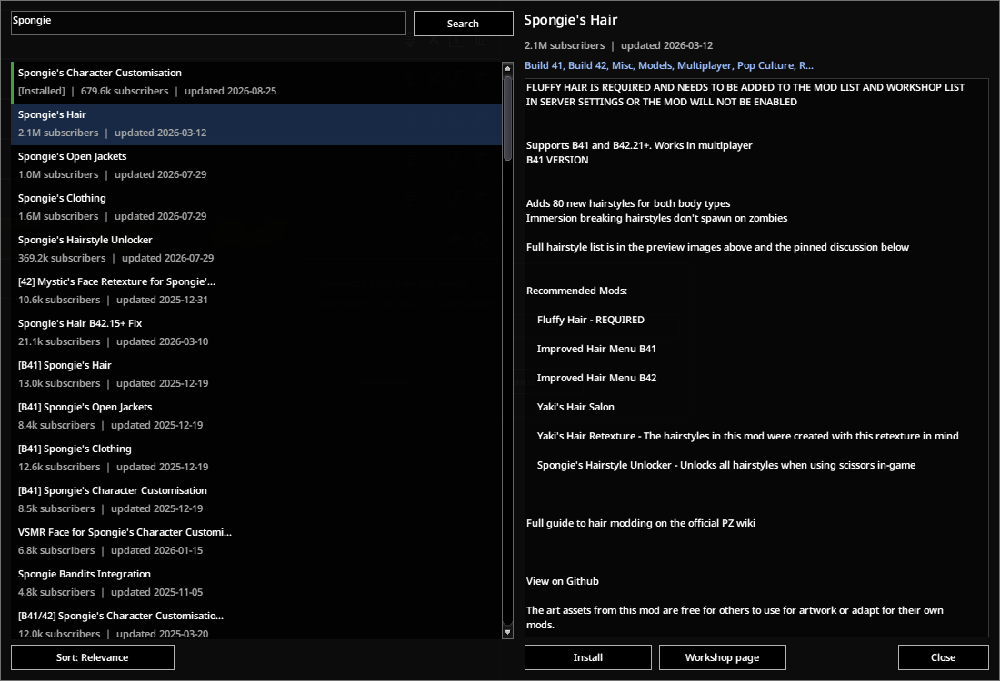

# WorkshopBridge

Download and update Steam Workshop mods from inside Project Zomboid. Built for non-Steam (GOG) players who can't use the Steam Workshop directly.

## Recommended Mods

- [Mod Folders](https://steamcommunity.com/sharedfiles/filedetails/?id=3779201168)
- [Enable Reset Lua Button](https://steamcommunity.com/sharedfiles/filedetails/?id=3487511907)

## Docs

- [Installation](docs/INSTALL.md) - ZombieBuddy setup, installing the mod, steamcmd options, Windows notes, troubleshooting
- [Building](WorkshopBridge/java-src/README.md) - compile the Java backend with Gradle
- [Architecture](docs/ARCHITECTURE.md) - Lua/Java contract, data flows, map format, how the check/update/download/adopt flows work
- [Testing](docs/TESTING.md) - how to run the offline suites and the online smoke test

**Disclaimer:** Vibecoded, Most of the source code manually reviewed and tweaked, but still. 
